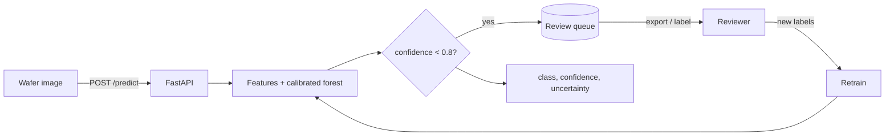
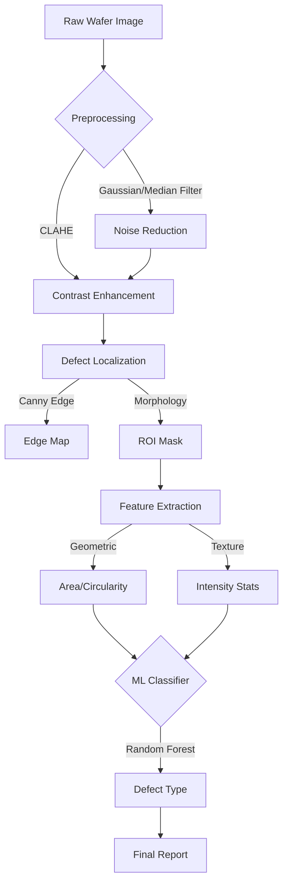

# WaferDefectX: wafer defect inspection with an active-learning review loop

Classical-CV defect localisation (Python and C++), plus an inference service that returns a **class, a calibrated confidence and an uncertainty score** for each wafer map, **queues low-confidence wafers for human review**, exports the queue, and records reviewer labels so they can feed the next training round. A script estimates how many labels are needed to hit a target accuracy with uncertainty sampling vs random sampling. All data is synthetic; CPU only; free to host.



Design doc (requirements, diagrams, API, failure modes, ADRs, costs): [docs/DESIGN.md](docs/DESIGN.md).

## Quickstart

```bash
docker compose up --build                 # trains on synthetic wafers during the build, serves on :8000
curl -s -F file=@samples/ambiguous_1.png localhost:8000/predict
curl -s "localhost:8000/queue/export?format=csv"
```

Open `http://localhost:8000` for clickable sample wafer maps. Without Docker: `pip install -r requirements-dev.txt && python -m wafer_inspect.train && uvicorn wafer_inspect.api:app`.

## Active-learning loop

- `POST /predict` returns `label, confidence, uncertainty, probabilities, needs_review, queue_id`. Wafers with confidence below `REVIEW_CONFIDENCE_THRESHOLD` (default 0.8) are stored in a SQLite queue.
- `GET /queue` (most uncertain first), `GET /queue/export?format=csv|json&status=`, `GET /queue/{id}/image`, `POST /queue/{id}/label`.
- `python -m wafer_inspect.active_learning --target 0.9` simulates the loop (start with 6 labels, add 5 at a time) and prints labels needed for the target accuracy, uncertainty vs random. It takes about a minute on CPU. CI runs it and prints the result in the job summary; see the latest run for numbers.

## Results

What was measured (synthetic wafers from `wafer_inspect/synth.py`: Gaussian noise, defect contrast from 3% to 100%; 600 train / 400 test wafers; `python -m wafer_inspect.train`, run on Apple M5, 16 GB):

| Metric | Value |
|---|---|
| Held-out accuracy (calibrated forest) | 0.930 |
| Expected calibration error, raw forest | 0.019 |
| Expected calibration error, after Platt calibration | 0.019 |

Calibration changed ECE negligibly here because the forest was already well calibrated on this data. Active-learning run (3 seeds, pool 800, test 400, target accuracy 0.90, same machine): uncertainty sampling needed a median of 16 labels (16, 16, 21) vs 26 for random sampling (41, 21, 26); with all 800 pool labels the model reaches 0.925. Three seeds on synthetic data is a small sample; treat the gap as indicative. CI regenerates all of these and prints them in the job summary.

## Performance measurements

The old "C++ 2.1 ms / 4x faster" figure was an unmeasured estimate and has been removed. `benchmarks/bench.py` now measures the Python/OpenCV and C++ pipelines (preprocessing plus localisation, excluding image decode) on the committed 800x800 images and prints the hardware next to the numbers. The `benchmark` CI job builds the C++ core and runs it on the GitHub Actions runner CPU; results appear in that job's summary and as the `bench` artifact. Measured in CI run 39052649982 (GitHub Actions, AMD EPYC 9V45, 4 vCPU, Ubuntu 24.04, OpenCV 4.9; 79 images x 3 repeats):

| Path | median | p95 |
|---|---|---|
| Python + OpenCV pipeline | 7.49 ms | 8.72 ms |
| C++ pipeline | 8.96 ms | 11.10 ms |
| Service `/predict` (end to end) | 21.9 ms | 27.5 ms |

The C++ port is about 20% slower than the Python path here: the Python pipeline already runs inside OpenCV's optimised native code, so a direct port adds no speed. No other speed claim is made.

## Limitations

- Synthetic data only. Accuracy and calibration say nothing about real fab imagery, and the model is not validated on real defects.
- Confident mistakes happen: faint defects can be called "good" with high confidence, and the review queue cannot catch those.
- The CNN checkpoint under `results/` scored 36% on 300 freshly generated synthetic wafers (3 classes), close to chance; the service does not use it. The INT8 dynamic quantization (629 KB to 237 KB) was only measured for file size, never for accuracy.
- The queue is SQLite and the Space disk is ephemeral; export regularly. The demo has no authentication.

## Deployment

Free default: Docker locally, or a Hugging Face Docker Space. Set repo variable `HF_SPACE` and secret `HF_TOKEN`; `.github/workflows/deploy-hf.yml` syncs the service files to the Space on pushes to `main` and skips when they are unset. Config is environment-only (`.env.example`).

---

## Original classical-CV pipeline

### Architecture Diagram


---

## 🖼️ Results Gallery

### 1. Real-time Defect Detection
*Automated localization of surface defects with multi-class classification (Scratch, Particle; trained on a small synthetic set)*


---

### 2. End-to-End Classification Pipeline
*6-stage processing pipeline: Input → CLAHE → Edge Detection → Morphology → Feature Extraction → Classification*


---

### 3. Frequency-Domain Noise Suppression
*FFT-based filtering for wafer noise removal: Original vs Low-Pass vs Band-Pass filtered*


---

### 4. Filter Frequency Responses
*Visualization of Low-Pass, High-Pass, and Band-Pass filter masks in frequency domain*


---

### 5. Spectrum Analysis
*Spatial vs Frequency domain representation of wafer images*


---

## 📌 Project Overview
The system simulates a high-throughput inspection tool found in semiconductor fabs (e.g., Applied Materials). It is designed with modularity and performance in mind, with a Python pipeline and a C++ port of the same preprocessing and localisation.

### Key Features
- **Synthetic Data Generation**: Simulates realistic wafer maps with customizable defects.
- **Hybrid Pipeline**:
  - **Preprocessing**: Gaussian/Median filtering, CLAHE, Adaptive Thresholding.
  - **Localization**: Canny Edge Detection, Morphological Closing (CV).
  - **Feature Extraction**: Geometric (Area, Circularity) + Texture (Mean, StdDev).
  - **Classification**: Random Forest / SVM for defect typing.
  - **ONNX Inference**: Exported classification models to ONNX format for rapid, cross-platform inference via `onnxruntime`.
  - **OpenVINO Optimization**: Enabled Intel OpenVINO inference via `hummingbird-ml` conversion for maximized hardware acceleration.
- **Production Readiness**:
  - Modular code structure.
  - C++ implementation of core algorithms (Preprocessing & Localization).
  - CMake build system.

## 📂 Repository Structure
```
WaferDefectX/
├── python/                 # R&D Prototype
│   ├── data_generator.py   # Synthetic data creation
│   ├── preprocessing.py    # CV Filters
│   ├── defect_localization.py # ROI & Mask generation
│   ├── features.py         # Feature engineering
│   ├── classifier.py       # ML Model wrappers
│   ├── main.py             # Driver for visualization
│   ├── train_eval.py       # ML Training pipeline
├── frequency_analysis/     # Frequency-Domain Processing
│   ├── fft_filtering.py    # FFT-based noise suppression
│   └── spectrum_visualization.py  # Spectrum analysis tools
├── cpp/                    # Production Core (C++)
│   ├── CMakeLists.txt      # Build config
│   ├── preprocess.cpp      # Optimized CV
│   ├── defect_localization.cpp # Optimized Localization
│   └── main.cpp            # C++ Driver
├── data/                   # Datasets (Synthetic)
├── results/                # Visualizations & Models
├── wafer_inspect/          # Inference service, review queue, active learning
└── benchmarks/             # bench.py (measured latency)
```

## 🔬 Frequency-Domain Analysis
Explored **frequency-domain filtering for wafer noise suppression** using FFT-based techniques:
- **Low-Pass Filtering**: Removes high-frequency sensor noise while preserving defect structures
- **Band-Pass Filtering**: Isolates defect-relevant spatial frequencies for enhanced detection
- **Spectrum Visualization**: Analyzes frequency characteristics of wafer images and defects

Run frequency analysis:
```bash
cd WaferDefectX/frequency_analysis
python3 spectrum_visualization.py
```

## 🚀 Getting Started

### Prerequisites
- Python 3.8+
- OpenCV (`pip install opencv-python`)
- NumPy, Pandas, Scikit-Learn, Matplotlib
- C++ Compiler (GCC/Clang) + CMake + OpenCV C++ DEV Libraries (for C++ core)

### 1. Generate Data
Create synthetic wafer maps for development:
```bash
python3 WaferDefectX/python/data_generator.py
```

### 2. Run Python Pipeline
Visualize the detection steps on sample images:
```bash
python3 WaferDefectX/python/main.py
```
Results are saved to `WaferDefectX/results/`.

### 3. Train Classifier
Extract features from the dataset and train a Random Forest model:
```bash
python3 WaferDefectX/python/train_eval.py
```

### 4. Build C++ Core
To compile the C++ implementation:
```bash
cd WaferDefectX/cpp
mkdir build && cd build
cmake ..
make
./WaferDefectX_Run ../../data/synthetic/wafer_0000_particle.png
```
*Note: Ensure `OpenCV_DIR` is set if CMake cannot find OpenCV.*

## 🔬 design Decisions

### Classical CV vs Deep Learning
We chose a **Classical CV** approach for *Localization* because:
- **Speed**: Simple filtering and thresholding is orders of magnitude faster than a YOLO inference, crucial for high-throughput (WPH) inspection.
- **Interpretability**: Morphological operations provide clear, explainable boundaries compared to black-box neural networks.
- **Data Efficiency**: Does not require thousands of labeled annotations to find simple contrast-based defects.

We use **Machine Learning (RF/SVM)** for *Classification* of the localized regions to distinguish between defect types (Scratch vs Particle) based on computed features.

## 🏭 Production Considerations

The transition from R&D (Python) to Production (C++) typically involves the following optimizations and safeguards, which have been implemented in the core modules:

### 1. Robustness & Error Handling
- **Input Validation**: Rigorous checks for empty images, channel counts, and resolution mismatch.
- **Assertions**: `CV_Assert` used in critical paths to fail fast on invalid states (e.g., incorrect kernel sizes).
- **Structured Logging**: Standardized logging for traceability of pipeline execution events and errors.

### 2. Performance Profiling
- **Benchmarking tools**: `benchmarks/bench.py` measures per-image latency of both pipelines:
    - median / p95 / mean latency per image
    - hardware description printed with every result
- **Optimization Path**: a C++ port of preprocessing/localization exists; its speed relative to Python is measured by the `benchmark` CI job (see Performance measurements above).

### 3. Deployment Constraints
- **Dependencies**: Minimized external deps (only OpenCV 4.x required).
- **Frequency Domain**: For high-noise environments, the FFT-based filtering module (`frequency_analysis/`) provides superior noise suppression at the cost of higher compute load compared to spatial filtering.

## 📊 Model notes
- **Model compression**: the CNN uses PyTorch dynamic INT8 quantization on its Linear layers only (`results/cnn_wafer_model.pth` 629 KB -> `results/cnn_wafer_model_quantized.pth` 237 KB). Accuracy impact of quantization has not been evaluated, and the fp32 checkpoint itself performs near chance on fresh synthetic wafers (see Limitations).
- **Data**: the 79 committed wafer images are synthetic (good, particle, scratch); the real WM-811K dataset is not used.

## 📝 Future Work
- Retrain the CNN at a resolution that preserves small defects and measure INT8 accuracy.
- Support real WM-811K dataset parsing.
- Implement multi-threading/CUDA optimization in C++.

---
**Author**: Ashik Sharon M
**Date**: Jan 2026
