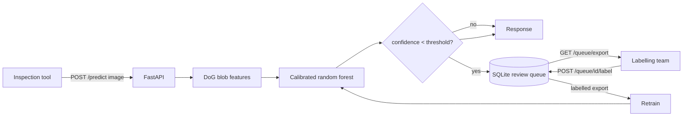
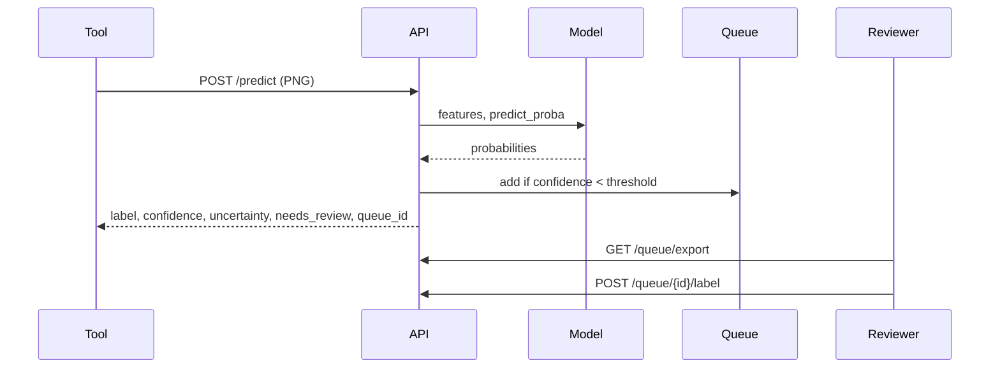

# Design: active-learning wafer inspection

## 1. Problem
An inspection line produces wafer maps faster than people can review them. The model should
classify what it is sure about, say how sure it is, and route the rest to a human, while
turning those human labels into the next round of training data.

## 2. Requirements
**Functional**
- `POST /predict`: class, calibrated confidence, uncertainty score, per-class probabilities.
- Wafers below a confidence threshold are queued for review (most uncertain first).
- Export the queue (JSON/CSV with image URLs), serve queued images, record reviewer labels, export labelled items.
- A script that estimates how many labels are needed to reach a target accuracy, with uncertainty vs random sampling.

**Non-functional**
- Free to run: CPU only, Docker or a Hugging Face Space, SQLite for the queue.
- No large datasets: all data is generated synthetically at train time; the repo ships 9+2 sample PNGs.
- JSON logs with request ids, env-only config, non-root container, health/readiness probes.

## 3. Architecture

## 4. Data model
`items(id, created_at, request_id, predicted_label, confidence, uncertainty, probabilities JSON, status pending|labelled, true_label, image PNG blob)`.
Model artifacts: `models/wafer_model.joblib` (calibrated sklearn estimator), `models/metrics.json` (held-out synthetic metrics from the training run).

## 5. API contract
| Endpoint | Purpose |
|---|---|
| `POST /predict` (multipart `file`) | `label, confidence, uncertainty, probabilities, needs_review, queue_id, request_id`; 400 undecodable, 413 too large, 503 no model |
| `GET /queue?status=pending&limit=` | queued wafers, most uncertain first |
| `GET /queue/export?format=json\|csv&status=` | export for labelling or retraining |
| `GET /queue/{id}/image` | the queued wafer PNG |
| `POST /queue/{id}/label` `{label}` | record the reviewer's label |
| `GET /queue/stats`, `/metrics-report`, `/samples`, `/healthz`, `/readyz`, `/docs` | metadata and probes |

## 6. Confidence and uncertainty
Features are noise-normalised difference-of-Gaussians blob statistics (peak z-score, blob count, area, elongation, extent). A random forest is wrapped in sigmoid (Platt) calibration with 3-fold cross-validation, so `confidence` is the calibrated top-class probability. `uncertainty` is the predictive entropy normalised to [0, 1]. Both come from the same probability vector; entropy additionally reflects how the remaining mass is spread. Expected calibration error before and after calibration is written to `metrics.json` and printed in CI.

## 7. Active-learning experiment
`python -m wafer_inspect.active_learning` starts from 2 labelled wafers per class, adds batches of 5 chosen at random or by least confidence, retrains, and records held-out accuracy. It reports labels needed for a target accuracy per seed. It runs in about a minute on CPU. It uses uncalibrated forest probabilities for speed, on synthetic data, and a handful of seeds, so treat the gap as indicative, not a benchmark.

## 8. Scaling path
The request path is stateless apart from the queue. Move the queue to Postgres and images to object storage, run replicas behind a load balancer, and swap the forest for a CNN once real labelled data exists (the feature interface is the only coupling). Retraining is a batch job over the labelled export.

## 9. Failure modes
| Failure | Mitigation |
|---|---|
| Model file missing | `/healthz` reports degraded; `/readyz` and `/predict` return 503 |
| Bad or huge upload | 400 / 413 before any model work |
| Confident but wrong | Not caught by the queue; faint defects can be misread confidently (see limitations); audit a random sample of "confident" wafers |
| Queue DB lost | Container volume in compose; on a Space the disk is ephemeral, export regularly |
| Input scale differs from training | Inputs are resized to 512x512, but optics differing from the synthetic generator will shift features and calibration |

## 10. Security and privacy
Uploads are decoded with OpenCV only (no pickle/exec of user data), size-capped, never written to disk outside the queue DB. Non-root container, CodeQL and Dependabot enabled, no secrets in the repo. Queue images may be sensitive in a real fab; the Space default has no auth, so do not feed it real production images without adding it.

## 11. Decisions
- **ADR-1 Classical features + forest, not the committed CNN.** The CNN checkpoint in `results/` scored 36% on 300 freshly generated synthetic wafers (3 classes), close to guessing, because the 64x64 input likely erases small defects. It stays in the repo as a research artifact; the service does not use it.
- **ADR-2 Platt calibration over temperature scaling.** The estimator outputs probabilities, not logits.
- **ADR-3 SQLite queue.** Zero infrastructure and transactional; limited to one writer node.
- **ADR-4 Synthetic data with a contrast knob.** No real wafer dataset is available locally; the knob creates genuinely ambiguous cases.
- **ADR-5 Hugging Face Docker Space.** Free; sleeps when idle, ephemeral disk.

## 12. Cost (free tier)
| Item | Service | Cost |
|---|---|---|
| CI, CodeQL, registry | GitHub Actions / GHCR (public repo) | $0 |
| Demo | Hugging Face Space, CPU basic | $0 (sleeps when idle) |
| Local | Docker Compose | $0 |
